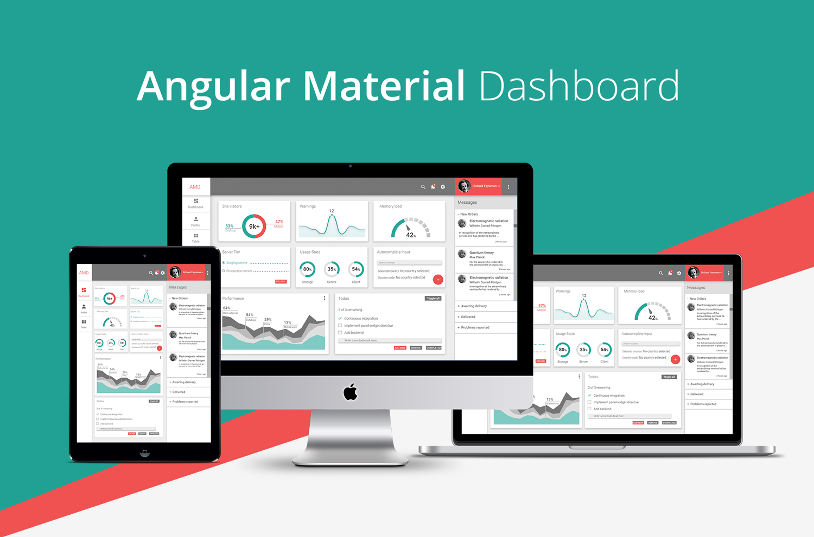

# Angular Material Dashboard

[View Demo](https://flatlogic.com/admin-dashboards/angular-material-dashboard/demo) | [Download](https://github.com/flatlogic/angular-material-dashboard.git) | [More templates](https://flatlogic.com/templates) | [Support forum](https://flatlogic.com/forum)

The Angular Material Dashboard provides a responsive admin interface that leverages [Angular Material](https://github.com/angular/material). for its design principles. It embodies the principles of material design, ensuring a cohesive and intuitive user experience, ideal for developing sophisticated [business software](https://flatlogic.com/) dashboards.

## Getting started

Clone project:

    $ git clone https://github.com/flatlogic/angular-material-dashboard.git

Install dependencies:

    $ cd angular-material-dashboard
    $ yarn install
    
Run development web-server:

    $ gulp serve

## Features

* AngularJS
* Angular UI Router
* Angular Material
* Sass styles
* Gulp build
* Stylish, clean, responsive layout with original design
* BrowserSync for the ease of development

## Project structure and credits

Project structure based on [gulp-angular yeoman generator](https://github.com/Swiip/generator-gulp-angular).
If you have any questions about the build or project structure please check out their documentation.

UI components built with [Angular Material](https://material.angularjs.org/).

Design by [flatlogic.com](http://flatlogic.com/)

## Deploy to Github pages  
  
    $ gulp build
    $ gulp deploy

## Support
For any additional information please go to our [**support forum**](https://flatlogic.com/forum) and raise your questions or feedback provide there. We highly appreciate your participation!

## Community
- [Tweet about it](https://twitter.com/intent/tweet?text=Angular%20Material%20Dashboard%20https://github.com/flatlogic/angular-material-dashboard%20via%20@flatlogicinc) to support revolution in classic paid templates market.
- Follow [@flatlogicinc on Twitter](https://twitter.com/flatlogicinc).
- Subscribe to Flatlogic newsletter at [flatlogic.com](http://flatlogic.com/)

## More from Flatlogic
- [💥Sing App Dashboard](https://github.com/flatlogic/sing-app) - Free and open-source admin dashboard template built with Bootstrap 4 
- [React Native Starter](https://github.com/flatlogic/react-native-starter) - 🚀 A powerful react native starter template that bootstraps development of your mobile application

## Premium themes
Looking for premium themes and templates? Check out our other template at [flatlogic.com](https://flatlogic.com/templates).

## Dependency maintenance

Use Node 22.23 or newer and npm. Install with `npm ci`, then run
`npm run install:client` to install the pinned Bower browser assets. The build
uses Gulp 5 and Dart Sass; `npm run build` creates `dist`. `npm start` serves the
source app without opening a browser. `npm run test:build`, `npm test` (set
`CHROME_BIN` to installed Chrome when needed), and `npm run test:e2e` exercise the
actual template, including production bundles and navigation. Playwright uses
installed Chrome; no browser download is required. `gulp deploy` retains the
GitHub Pages publish capability through the maintained gh-pages API and is not
part of build/test checks.

Gulp filters explicitly include dot paths so builds under `.codex` process their
CSS/JavaScript. Binary images/fonts are copied without text decoding. The former
Protractor spec had no assertions and referenced a missing generator config; the
Chrome navigation regression replaces it. Existing AngularJS services now have
real asynchronous data tests.

The npm audit covers build dependencies. Browser packages installed by Bower are
separate: AngularJS and AngularJS Material have ended upstream support. They are
updated to their final public releases here, but npm audit zero must not be read
as a claim that these EOL browser frameworks have no known security issues.
Migrating the complete UI to another framework is a separate product migration.

The November security followup applies verified public Debian backports and
small local fixes while preserving AngularJS 1.8.3 APIs and application routes.
[The exact patch manifest, provenance and verification boundaries](build/angularjs-patches/README.md)
cover SCE URL matching, SVG/image policies, currency/copy/URL/srcset DoS and the
linky filter. Both raw/minified browser distributions and source maps are updated
after exact-input verification; unknown changes fail loudly. Existing package
version metadata remains unchanged, so upstream advisories remain visible.

The official Debian srcset patch also needed a local compatibility correction
to retain valid data URLs without restoring the vulnerable regex. Browser tests
exercise actual framework APIs with allowed/rejected policies, exploit-sized
inputs, valid data URLs and the normal dashboard/profile/table routes. The build
minifier lock is refreshed within its existing UglifyJS 3 range to parse the
backports' JavaScript syntax.

Internet Explorer's textarea history-cache issue (CVE-2022-25869) remains an
explicit unverified/unfixed boundary. Current Chrome is tested; IE support and
a wholly vulnerability-free legacy framework are not claimed. `angular-resource`
is absent, so its separate service advisory has no installed implementation here.
